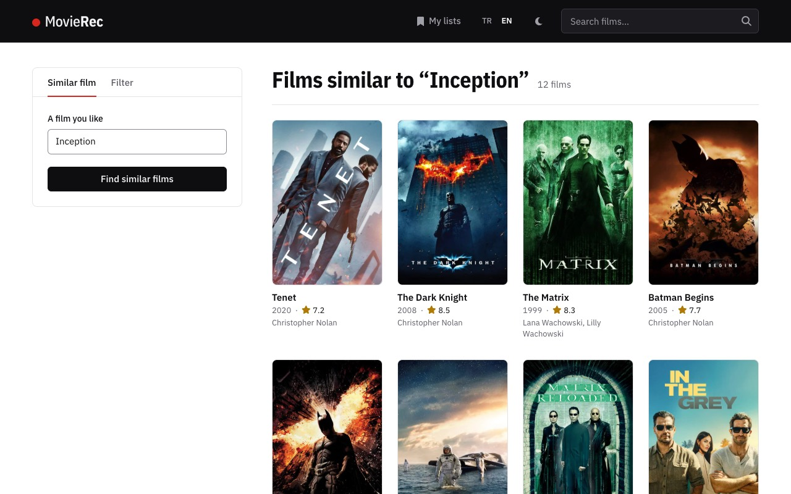
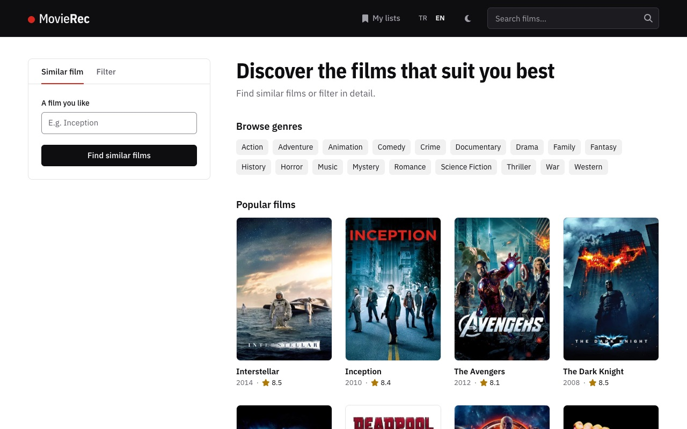
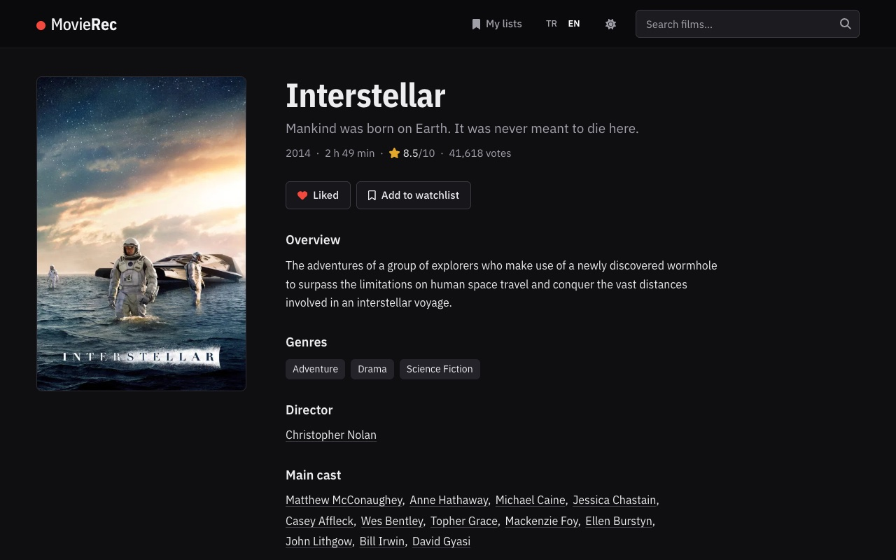
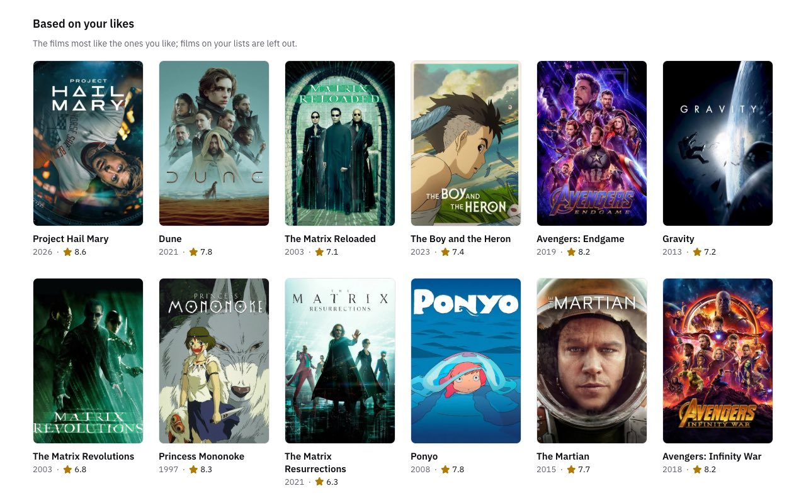

# MovieRec

[](https://github.com/alimustafaekmen/Movie-Recommendation/actions/workflows/ci.yml)
[](LICENSE)

**English** | [Türkçe](README.tr.md)

MovieRec is a content-based movie recommender for TMDb films. Live demo with about 14,000 films: [movierec.pages.dev](https://movierec.pages.dev)

The demo shows results computed in advance; its person pages have no biography and list only films from the dataset.

Stack: Python 3.12, Flask, pandas, scikit-learn (TF-IDF, cosine similarity), thefuzz, vanilla JavaScript, Docker, gunicorn, GitHub Actions.

## Screenshots

<a href="screenshots/en/similar-movies.jpg"></a>

<p>
  <a href="screenshots/en/home.jpg"></a>
  <a href="screenshots/en/movie-page-dark.jpg"></a>
  <a href="screenshots/en/my-lists.jpg"></a>
</p>

## Features

- **Similar movies:** enter a title and get 12 similar films, or 24 with "Show more".
- **Filter search:** by genres, director, release years and minimum rating.
- **Movie and person pages:** posters, overviews, trailers, cast and biographies from the TMDb API.
- **Favourites and watchlist:** kept in the browser, with no accounts. The lists page suggests films based on your favourites.
- **Light and dark theme:** follows the system setting. A button in the header switches it.
- **Turkish and English:** the whole interface, including genre names, dates, numbers and TMDb texts.

## How it works

1. Each film becomes four TF-IDF blocks: genres, directors, keywords and text.
2. Cosine similarity on the joined blocks finds the 91 closest films. They form a pool.
3. Each film in the pool gets a new score from its similarity, rating, popularity and vote count.
4. The app shows the top 12.

TF-IDF is used instead of collaborative filtering because there is no user data, and the terms behind a match are easy to inspect.

| Block | Input | Weight |
|---|---|---|
| Genres | whole genre names ("Science Fiction" is one term) | 0.3 |
| Directors | whole names, each co-director separate | 0.2 |
| Keywords | single words | 0.4 |
| Text | overview and tagline, without common English words | 0.6 |

Each block is normalised before it is weighted. With the overview in its own block, a rare word such as a character name seldom links two unrelated films on its own.

The re-ranking weights:

| Signal | Scaled as | Weight |
|---|---|---|
| Content similarity | divided by the best match in the pool | 0.50 |
| Vote average | divided by 10 | 0.20 |
| Popularity | log(1 + x), divided by the pool's maximum | 0.20 |
| Vote count | log(1 + x), divided by the pool's maximum | 0.10 |

Films under 100 votes are dropped when the pool has a film with 100 votes or more. The weights are round numbers chosen by hand and are in [movierec/config.py](movierec/config.py). With a director weight of 0.5, all of Jaws's top 8 were Spielberg films, so directors weigh only 0.2.

Title search prefers an exact match, ignoring case, accents and apostrophes. Otherwise thefuzz picks the closest title, which allows for typos.
With the refreshed catalogue, Turkish titles match too: "baslangic" finds *Inception*.

The suggestions on the lists page take your 20 most recent favourites and get 30 similar films for each. Films that several favourites share move up, and the page shows the top 12 that are not on your lists yet.

Filter search keeps the films that match every filter and ranks them by `0.40 * rating + 0.45 * popularity + 0.15 * vote count`. Rating is divided by 10. Popularity (on a log scale) and vote count are divided by the largest value among the matches. Films under 100 votes are left out unless nothing else matches.

## Evaluation

There is no user data to test against, so `scripts/evaluate.py` takes every film as a seed and checks its 12 similar films. It compares the app's lists with pure cosine similarity and with a baseline that gives every seed the same 12 most-voted films.

On the Kaggle files (4,803 films):

| Method | Genre overlap | Same director | Shared lead actor | Series recall | Catalog coverage | Median votes |
|---|---|---|---|---|---|---|
| Pure cosine | 0.744 | 5.6% | 3.48% | 76.7% | 98.5% | 191 |
| MovieRec (re-ranked) | 0.739 | 5.0% | 3.55% | 75.1% | 61.7% | 1,350 |
| Most-voted baseline | 0.159 | 0.1% | 0.75% | 1.1% | 0.3% | 10,099 |

On the refreshed catalogue of about 14,000 films, the re-ranked lists have a genre overlap of about 0.76 and reach over 80% of the films.

- The numbers measure coherence, not whether people like the lists.
- Genres and directors are model inputs, so the first two columns partly measure what the model was given.
- Most of the coverage gap comes from the 100-vote floor. The re-ranked lists reach 94% of the films with 100 votes or more.

## Run locally

You need Python 3.12 and the [TMDB 5000 dataset](https://www.kaggle.com/datasets/tmdb/tmdb-movie-metadata) from Kaggle.

1. Put `tmdb_5000_movies.csv` and `tmdb_5000_credits.csv` in `dataset/`.
2. Run `cp .env.example .env` and add your [TMDb API key](https://www.themoviedb.org/settings/api) (v3). Without it the app uses the dataset alone, with no posters, trailers or person pages. See `.env.example` for the other settings.
3. Install and start the app:

   ```bash
   python -m venv .venv && source .venv/bin/activate
   pip install --require-hashes -r requirements.lock.txt
   python app.py
   ```

4. Open http://localhost:5001.

The Kaggle files end in 2016. With your TMDb key, `python scripts/fetch_catalogue.py` adds up to 400 of the most-voted films for each year since 1990.
It writes them to `dataset/refreshed/`, which git ignores. Set `DATASET_DIR=dataset/refreshed` in `.env` to use them.
TMDb's terms allow keeping the data for at most 6 months, so run the script again at least that often.

For Docker, put the CSVs in `dataset/` first, then run `docker compose up --build` to serve the app with gunicorn at http://localhost:5001.
The image holds TMDb data, so never push it to a registry.

## Dependencies

`requirements.txt` pins the direct dependencies, and CI and Docker install from `requirements.lock.txt`, which pins every package with hashes. After a change to `requirements.txt`, regenerate the lockfile with [uv](https://docs.astral.sh/uv/):

```bash
uv pip compile --universal --python-version 3.12 --generate-hashes --exclude-newer 14d requirements.txt -o requirements.lock.txt
```

Leave out `--exclude-newer 14d` when a security fix is younger than 14 days.

## Tests

```bash
ruff check . && ruff format --check .
pytest --cov
node --test "tests/js/*.test.mjs"
```

Without the Kaggle CSVs, pytest uses a small sample in `tests/fixtures/`. CI runs the same commands on every push and pull request.

## Project layout

```text
app.py                  entry point (gunicorn app:app)
movierec/
  dataset.py            CSV loading and cleaning
  similarity.py         TF-IDF matrix and ranking formulas
  engine.py             similar movies, filter search and title search
  tmdb.py               small TMDb API client
  i18n.py               Turkish and English texts and formats (messages.json)
  web/                  Flask routes, security headers and language choice
templates/              Jinja templates
static/                 CSS, JavaScript, icons and fonts
scripts/                evaluate.py and fetch_catalogue.py
tests/                  pytest suite, with the node:test suite in tests/js/
```

## Limitations

- The catalogue ends on the day it was downloaded. Recommendations only come from the films loaded.
- Films before 1990 come only from the Kaggle set, so those years are thinner.
- Popularity is TMDb's trend score on the download day. Films that are in cinemas on that day move up.
- Recommendations use content only. Films with thin metadata mostly get films of the same genre.
- Non-English films rarely get picks in their own language.
- The lists need JavaScript and stay in one browser on one device.
- The app is made to run on your own computer. To put it on the internet, add a reverse proxy such as nginx or Caddy. It should read whole requests before passing them on, because slow clients can otherwise hold all of gunicorn's threads. It should also limit requests per visitor to `/api/`, `/movie/`, `/actor/` and `/director/`, which call TMDb with your key.

## License and credits

The source is available under the [PolyForm Noncommercial License 1.0.0](LICENSE). You may use it for personal, educational and other noncommercial purposes. Commercial use is not allowed.

- Movie data and images come from [TMDB](https://www.themoviedb.org/). This website uses TMDB and the TMDB APIs but is not endorsed, certified, or otherwise approved by TMDB.
- The base dataset is the [TMDB 5000 Movie Dataset](https://www.kaggle.com/datasets/tmdb/tmdb-movie-metadata) on Kaggle.
- The icons in `static/icons.svg` are from [Font Awesome Free 6.5.1](https://fontawesome.com), under their own [CC BY 4.0 license](https://fontawesome.com/license/free).
- The fonts are [IBM Plex Sans and IBM Plex Sans Condensed](https://github.com/IBM/plex), under the SIL Open Font License 1.1 (`static/fonts/OFL.txt`). The site serves the font files itself.
