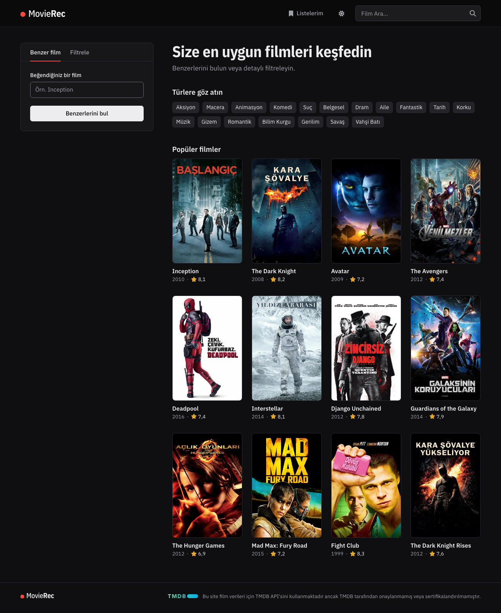
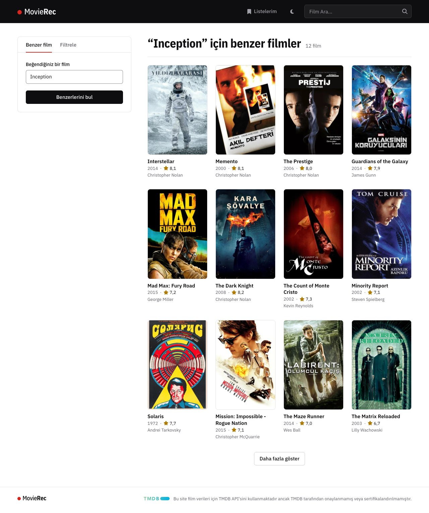
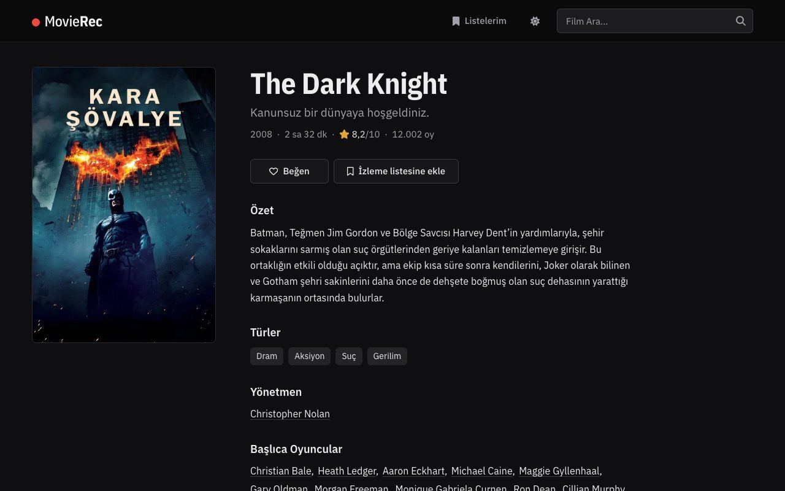
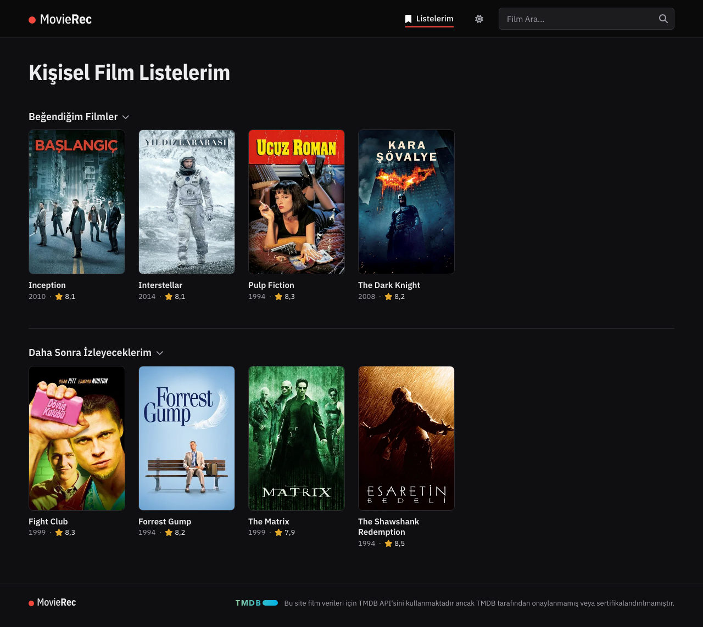

# MovieRec

[](https://github.com/alimustafaekmen/Movie-Recommendation/actions/workflows/ci.yml)
[](LICENSE)

**English** | [Türkçe](README.tr.md)

**Contents:** [Screenshots](#screenshots) · [Features](#features) · [How it works](#how-it-works) · [Evaluation](#evaluation) · [Run locally](#run-locally) · [Tests](#tests) · [Configuration](#configuration) · [Project layout](#project-layout) · [Limitations](#limitations) · [License and credits](#license-and-credits)

MovieRec is a content-based movie recommender built with Flask. Give it a film you like and it finds similar films. You can also search by genre, director, year and rating. The interface is in Turkish.

By default it uses the 4,803 films of the [TMDB 5000 dataset](https://www.kaggle.com/datasets/tmdb/tmdb-movie-metadata) on Kaggle, which ends in late 2016. It can also use a fresh catalogue of about 9,000 films up to 2026, which `scripts/fetch_catalogue.py` fetches with your own TMDb API key (see [Run locally](#run-locally)). Unless a section says otherwise, the numbers in this README were measured on the Kaggle files.

**Live demo:** [movierec.pages.dev](https://movierec.pages.dev)

The demo is a static copy with results computed in advance. Its person pages have no biography and list only films from the dataset.

## Screenshots

<p>
  <a href="screenshots/home.jpg"></a>
  <a href="screenshots/similar-movies.jpg"></a>
  <a href="screenshots/movie-page-dark.jpg"></a>
  <a href="screenshots/my-lists.jpg"></a>
</p>

## Features

- **Similar movies:** enter a title and get 12 similar films, or up to 30 with "Daha fazla göster".
- **Filter search:** by genres, director, release years and minimum rating.
- **Movie and person pages:** posters, Turkish overviews, trailers, cast and biographies from the TMDb API.
- **Favourites and watchlist:** kept in your browser, so there are no accounts and no database. The lists page also suggests films based on your favourites ("Beğendiklerinize göre").
- **Light and dark theme:** follows your system setting. A header button switches it.

## How it works

### Similar movies

Each film becomes four TF-IDF blocks. TF-IDF turns text into numbers: a term scores high when it is common in one film but rare across all films.

| Block | What goes in | Weight | Share of the similarity |
|---|---|---|---|
| Genres | whole genre names ("Science Fiction" is one term) | 0.3 | 14% |
| Directors | whole names, each co-director separate | 0.2 | 6% |
| Keywords | single words, because over half of the keyword phrases belong to only one film | 0.4 | 25% |
| Text | overview and tagline, without common English words such as "the", at most 20,000 terms | 0.6 | 55% |

Each block is L2-normalised (every film's row is scaled to length 1) and multiplied by its weight. The joined row is normalised again. Films are then compared with cosine similarity, which measures how much two rows point the same way, from 0 to 1. The result is a weighted mean of the four block similarities, where each block counts with the square of its weight. The last column shows these shares for a film with all four fields.

Separate blocks limit how much the overview can decide. The earlier model put all fields into one text, so a rare character name could link unrelated films. Toy Story's top 5 included *The 40 Year Old Virgin* because both overviews mention "Andy".

- Earlier model: Toy Story 2, Toy Story 3, Monsters, Inc., Small Soldiers, The 40 Year Old Virgin
- Now: Toy Story 3, Toy Story 2, Monsters, Inc., Big Hero 6, Inside Out

The model is a sparse 4,803 × 29,665 matrix of about 2.5 MB. Sparse means it stores only the non-zero values. No film-by-film table is stored. A film's similarities are one sparse matrix product, computed on request.

### Re-ranking

The 91 most similar films form a pool. That is three times the longest list (30), plus one. Each film in the pool gets a score:

| Signal | Scaled as | Weight |
|---|---|---|
| Content similarity | divided by the best match in the pool | 0.50 |
| Vote average | divided by 10 | 0.20 |
| Popularity | log(1 + x), divided by the pool's maximum | 0.20 |
| Vote count | log(1 + x), divided by the pool's maximum | 0.10 |

- Similarities in a pool are close together. Dividing by the best match uses the full 0-1 range.
- Popularity has a median of 13 and a maximum of 876. Without the log, one blockbuster would push every other film's popularity score close to 0. Vote counts are similar.
- TMDb ratings are noisy below 100 votes. Such films are dropped when the pool has a film with at least 100 votes.
- The pool size is fixed, so asking for more results never changes the order of the first ones.

### How the weights were chosen

The weights are round numbers picked by hand, because there is no user data to tune them on. They were checked by reading the lists of well-known films and with the columns of `scripts/evaluate.py`.

- **First try (genres 0.4, directors 0.5, keywords 0.3):** 438 films got 8 or more of their 12 picks from their own director. Jaws's top 8 were all Spielberg films.
- **Directors down to 0.3:** 26 films. But same-genre films pushed out films with the same theme. Seven Samurai got boxing films at places 1 and 2. Series recall fell to 70.9%, below the earlier model's 75.4%.
- **Now (genres 0.3, directors 0.2, keywords 0.4):** 1 film. Seven Samurai's boxing films move down to places 4 and 5. Series recall is 75.1%, close to the earlier model.

The weights are in [movierec/config.py](movierec/config.py).

### Based on your favourites

The lists page sends your favourite and watchlist ids to the server. The server takes the 20 most recently added favourites that are in the dataset and gets 30 similar films for each.

- A film at rank r (counting from 0) in a list scores 1 / (r + 1). Scores add up across the lists, so films that several favourites share move up.
- Films already on either list are left out. Ties keep the order in which films first appear.
- The page shows the top 12. The server stores nothing.

### Filter search

The search keeps films that match every selected genre, the director, and the year and rating limits. A co-directed film matches any of its directors. Films under 100 votes are left out unless nothing else matches. The rest are ranked by:

```text
0.40 * rating + 0.45 * popularity + 0.15 * vote count
```

Rating is divided by 10. Popularity is taken as log(1 + x), as in similar movies, so one trending film does not push every other film's popularity score close to 0. Popularity and vote count are divided by the largest value among the matches.

### Title search

An exact title match wins, ignoring case. Otherwise the app takes the closest title by fuzzy matching, which allows for typos. It uses thefuzz `WRatio` and needs a score of at least 75 out of 100. A title shorter than half the query only counts if the query contains all its words. So "Godfather 2" finds *The Godfather*, not *Her*. When several films share a title, the most-voted one wins.

## Evaluation

There is no user data to test against. So `scripts/evaluate.py` takes every film in turn as the seed (the starting film) and checks its 12 similar movies. Do they agree with the seed on metadata? Do they find its series? How much of the catalogue do they reach? How popular are they?

```bash
python scripts/evaluate.py
```

On the Kaggle files (4,803 films):

| Method | Genre overlap | Same director | Shared lead actor | Series recall | Catalog coverage | Median votes |
|---|---|---|---|---|---|---|
| Pure cosine | 0.744 | 5.6% | 3.48% | 76.7% | 98.5% | 191 |
| MovieRec (hybrid) | 0.739 | 5.0% | 3.55% | 75.1% | 61.7% | 1,350 |
| Most-voted baseline | 0.159 | 0.1% | 0.75% | 1.1% | 0.3% | 10,099 |
| Earlier model, pure cosine | 0.356 | 4.5% | 3.23% | 76.4% | 98.6% | 284 |
| Earlier model, hybrid | 0.335 | 4.0% | 3.15% | 75.4% | 64.1% | 1,630 |

*Pure cosine* is the top 12 by content similarity alone. *MovieRec (hybrid)* is what the app shows. The *most-voted baseline* gives every seed the same 12 most-voted films. The *earlier model* (commit dc815a0) used one TF-IDF over all fields and linear popularity. Its rows come from the same metric code run on that commit. The script prints only the first three rows.

- **Genre overlap:** the mean Jaccard index of the seed's and the recommendation's genres. Jaccard is shared genres divided by all genres of the two films. Seeds without genres are skipped.
- **Same director:** the share of recommendations that share a director with the seed.
- **Shared lead actor:** the share whose three top-billed actors include one of the seed's three. Cast is not a model input.
- **Series recall:** the share of the seed's series films found in its 12. A series film has a different title that starts with the same words (such as "Star Trek") and at least 100 votes. It is averaged over the 464 films that have any. About 1 title group in 10 is not a real series, for example Kung Fu Hustle and Kung Fu Panda.
- **Catalog coverage:** the share of all films recommended at least once.
- **Median votes:** the median vote count of all recommendations, counting a film each time it appears. The dataset median is 235.

What the numbers show and what they do not:

- They measure coherence, not accuracy. They show whether a list hangs together, not whether people would like it.
- Genres and directors are model inputs, so the first two columns mostly measure what the model was given. With the genre weight set to 0, the hybrid's genre overlap is 0.312. So the jump from 0.335 to 0.739 mostly shows the model doing what it was told.
- Shared lead actor does not show that the new model is better. Directors reuse actors, so this column rises with the director weight. Without same-director pairs, every model scores about 2.0% to 2.2%. Series recall is partly built in too, because sequels share character names in their overviews.
- The hybrid trades a little agreement and about 37 percentage points of coverage for better-known films (median 1,350 votes against 191). Log scaling lowers that median on purpose. With linear scaling it is 1,553.
- Most of the coverage gap comes from the 100-vote floor. Only 3,162 films (65.8%) have 100 votes or more, and the hybrid reaches 94% of them.

On the refreshed catalogue fetched on 2026-10-22 (8,966 films, dataset median 780 votes), with `DATASET_DIR=dataset/refreshed python scripts/evaluate.py`:

| Method | Genre overlap | Same director | Shared lead actor | Series recall | Catalog coverage | Median votes |
|---|---|---|---|---|---|---|
| Pure cosine | 0.758 | 5.5% | 3.68% | 64.8% | 99.3% | 764 |
| MovieRec (hybrid) | 0.761 | 5.0% | 3.66% | 62.0% | 81.4% | 3,593 |
| Most-voted baseline | 0.160 | 0.1% | 0.71% | 0.4% | 0.1% | 33,218 |

These numbers cannot be reproduced without a TMDb API key, and they change with each refresh.

- Genre overlap, same director and shared lead actor stay about the same.
- Coverage rises from 61.7% to 81.4%, mostly because 8,274 films (92.3%) have 100 votes or more.
- Median votes are higher because today's vote counts are about 3 times higher. Against the dataset median, the hybrid leans less on popular films: 4.6 times the median, against 5.7 times on the Kaggle files.
- Series recall falls from 75.1% to 62.0%. Many more seeds have series films (1,362 against 464), so the title groups are bigger and noisier. Counting only Kaggle seeds and their Kaggle series films, it is 71.3%, about 4 points below the Kaggle files, because new films take some of their places.

## Run locally

You need Python 3.12 and the two Kaggle CSV files.

1. Download `tmdb_5000_movies.csv` and `tmdb_5000_credits.csv` from [Kaggle](https://www.kaggle.com/datasets/tmdb/tmdb-movie-metadata) into `dataset/`.
2. Run `cp .env.example .env` and fill in two values:
   - `TMDB_API_KEY`: your TMDb API key, from your [TMDb account settings](https://www.themoviedb.org/settings/api). Use the "API Key" value (v3), not the longer "API Read Access Token". Without it the app uses the dataset alone, with no posters, trailers, Turkish overviews or person pages.
   - `FLASK_SECRET_KEY`: a random string that signs the flash-message cookie. Make one with `python -c "import secrets; print(secrets.token_hex(32))"`. Without it the app makes a new one on each start.
3. Install and run:

   ```bash
   python -m venv .venv && source .venv/bin/activate
   pip install -r requirements.txt
   python app.py
   ```

4. Open http://localhost:5001.

The dev server only listens on this computer (`HOST=127.0.0.1`). It uses port 5001 because macOS uses 5000 for AirPlay Receiver. `PORT=8000 python app.py` picks another port.

**Refreshed catalogue.** The Kaggle files end in late 2016. To add newer films, put your `TMDB_API_KEY` in `.env` and run:

```bash
python scripts/fetch_catalogue.py
```

The script keeps the Kaggle films and adds, for each release year since 2016, the 400 most-voted films that have at least 100 votes. It still needs the Kaggle files in `dataset/`, because it starts from their film ids. The run on 2026-10-22 wrote 8,966 films up to 2026 (18 MB) with about 9,200 requests in about 8 minutes. `--limit 50` makes a small trial run first. The files go to `dataset/refreshed/`, which git ignores. Set `DATASET_DIR=dataset/refreshed` in `.env` to use them. TMDb's terms allow keeping its data for at most 6 months, so run the script again at least every 6 months.

**Docker.** Put the Kaggle CSVs in `dataset/` first, and fetch the refreshed catalogue if you use it, because the image copies them in. An image built with them holds TMDb data, so never push it to a registry. Then `docker compose up --build` serves the app with gunicorn at http://localhost:5001. The container runs as a non-root user with a health check and no Linux capabilities. Its file system is read-only apart from an in-memory `/tmp`, and only this computer can reach it.

## Tests

```bash
pip install -r requirements-dev.txt
ruff check . && ruff format --check .
pytest --cov
node --test "tests/js/*.test.mjs"
```

What the tests protect:

- **Engine output:** a snapshot of title matches and similar-movie lists on the full dataset. After an intended ranking change, run `python tests/snapshot_engine.py --update` and review the diff.
- **TMDb failures:** after a timeout, server error or broken JSON, the page still loads with dataset data. The app makes one call and does not retry. Without an API key no call is made. The key never reaches the logs.
- **Security:** the Content Security Policy and other headers on every response, request size limits, and redirects that stay on the site.
- **Lists and evaluation:** the browser list store and the lists page (with `node:test`), and the metric helpers in `scripts/evaluate.py`.

Without the Kaggle CSVs, pytest uses a 158-film sample in `tests/fixtures/` and skips the tests that need the full dataset. Its overviews, taglines and keywords are short hand-written texts, not TMDB's. pytest never reads the refreshed catalogue, even when `.env` sets `DATASET_DIR`. CI runs the same commands on every push and pull request. It fails below 95% line and branch coverage of `movierec/` and `app.py`. The sample run measures about 96%. CI also builds the Docker image and checks that the app runs as the non-root user.

## Configuration

Set these in `.env` (`.env.example` lists them) or in the environment, which wins.

| Variable | Purpose | Default |
|---|---|---|
| `TMDB_API_KEY` | TMDb API key (v3) | unset (dataset only) |
| `FLASK_SECRET_KEY` | signs the flash-message cookie | random on each start |
| `DATASET_DIR` | folder with the two CSVs, such as `dataset/refreshed` | `dataset/` |
| `SESSION_COOKIE_SECURE` | set to `1` behind HTTPS for a Secure cookie and HSTS | off |
| `HOST`, `PORT`, `FLASK_DEBUG` | dev server options | `127.0.0.1`, `5001`, off |
| `LOG_LEVEL` | log level, also under gunicorn | `INFO` |

## Project layout

```text
app.py                  entry point (gunicorn app:app)
movierec/
  config.py             settings from the environment and .env
  dataset.py            CSV loading and cleaning
  similarity.py         TF-IDF matrix and ranking formulas
  engine.py             RecommendationEngine: similar movies and filter search, no network
  search_filters.py     input parsing, genre and director filters
  movie_details.py      movie pages and list cards with TMDb data
  genres.py             genre names and Turkish labels
  tmdb.py               small TMDb API client
  people.py             director and actor pages from TMDb
  web/
    __init__.py         app factory: config, security headers, error pages
    movies.py           home, movie, person and search routes, JSON suggestions
    lists.py            favourites and watchlist page, card and recommendation endpoints
    redirects.py        safe redirects back to the previous page
templates/              Jinja templates
static/                 CSS, JavaScript and icons. js/list_store.js keeps the lists in localStorage
scripts/
  evaluate.py           offline evaluation of the similar-movies lists
  fetch_catalogue.py    fetches a fresh catalogue from TMDb into dataset/refreshed/
tests/                  pytest suite. tests/js/ holds the node:test suite
```

## Limitations

- The catalogue is a snapshot. The Kaggle files end in late 2016. The refreshed catalogue ends on the day it was fetched, so films released after that are missing until the next fetch. Recommendations only come from the films loaded.
- The films before 2016 are an uneven selection. They come only from the Kaggle set, which has 122 of TMDb's 250 most-voted 2015 films. From 2016 on, each year has its 400 most-voted films, but 2026 has only 248 so far, because no more have reached 100 votes.
- Popularity is TMDb's trend score on the fetch day, not lasting fame. Films in cinemas on that day move up, and the lists change with each refresh. In the refreshed catalogue, 2025 and 2026 films are 7.2% of the films but get 11.8% of the places in similar-movie lists.
- The refreshed catalogue needs your own TMDb API key. TMDb's terms allow keeping it for at most 6 months, so it must be fetched again at least that often.
- Recommendations use content only and do not learn from users.
- Films with thin metadata get lists that mostly share their genres. Casablanca gets romances, not WWII films. Forrest Gump gets romantic comedies.
- Some series are linked only by their titles. Saw's list has none of its six sequels.
- Well-known films are favoured on purpose, so the lists reach only about 62% of the Kaggle catalogue (81% of the refreshed one).
- Non-English films rarely get picks in their own language. For the 298 non-English films, 2.9% of the picks share the film's original language.
- Filter search still scales vote count linearly, unlike similar movies.
- The lists need JavaScript. They belong to one browser on one device and disappear when its site data is cleared.

## License and credits

The source is available under the [PolyForm Noncommercial License 1.0.0](LICENSE). You may use it for personal, educational and other noncommercial purposes. Commercial use is not allowed.

- Movie data and images come from [TMDB](https://www.themoviedb.org/). This website uses TMDB and the TMDB APIs but is not endorsed, certified, or otherwise approved by TMDB.
- The base dataset is the [TMDB 5000 Movie Dataset](https://www.kaggle.com/datasets/tmdb/tmdb-movie-metadata) on Kaggle.
- The icons in `static/icons.svg` are from [Font Awesome Free 6.5.1](https://fontawesome.com), under their own [CC BY 4.0 license](https://fontawesome.com/license/free).
- The fonts are [IBM Plex Sans and IBM Plex Sans Condensed](https://github.com/IBM/plex), under the SIL Open Font License 1.1, loaded from Google Fonts.
