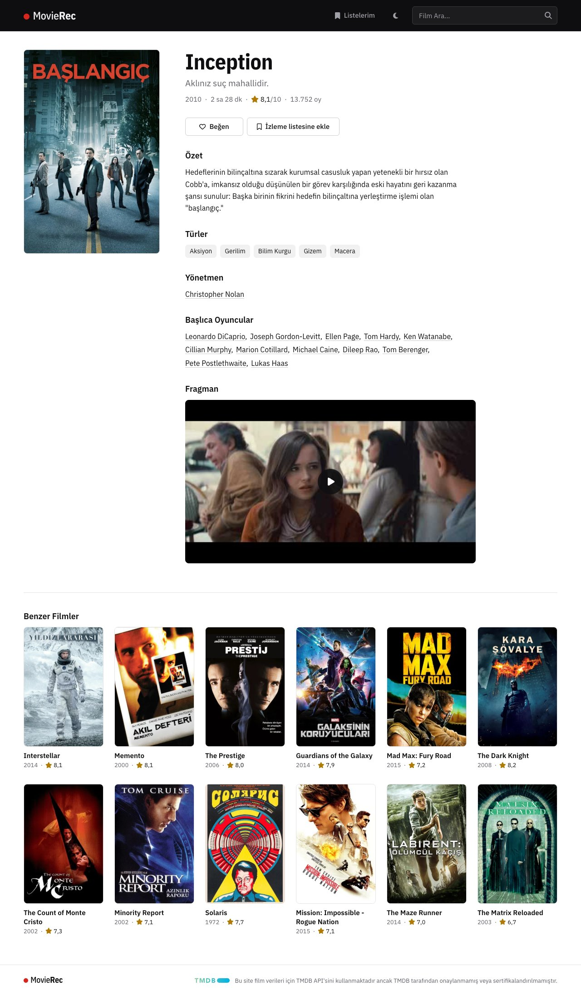

# MovieRec

MovieRec is a content-based movie recommender built with Flask on the [TMDB 5000 dataset](https://www.kaggle.com/datasets/tmdb/tmdb-movie-metadata). It finds films similar to one you like, or ranks films that match a set of filters (genres, director, release years, minimum rating). Movie and person pages are enriched with live data from the TMDb API: posters, trailers, cast and biographies. The interface is in Turkish.

There are no accounts. Favourites and the watchlist are kept in the visitor's browser, so the app keeps no accounts or lists on the server and needs no database. The site follows the system's light or dark setting, and a header button switches it.





## How recommendations work

**Similar movies.** Each film is turned into one text made of its genres, keywords, director, overview and tagline. A TF-IDF vectorizer (English stop words, up to 20,000 terms) converts these texts into L2-normalised vectors, so the cosine similarity between two films is a dot product. Only the sparse TF-IDF matrix is kept in memory; a film's similarity row is computed when it is needed.

For a query film, the 91 most similar films form a candidate pool, and each candidate gets a weighted score in which every signal is scaled to 0-1 within the pool:

| Signal | Weight |
|---|---|
| Content similarity (relative to the best match in the pool) | 0.50 |
| Vote average / 10 | 0.20 |
| Popularity | 0.20 |
| Vote count | 0.10 |

TMDb ratings are noisy below 100 votes, so such films are dropped whenever the pool contains a film with at least 100 votes. Because the pool size is fixed, asking for more results never reorders the top ones.

**Filter search.** Films that match every selected genre, the director and the year and rating bounds are ranked by `0.40 * rating + 0.45 * popularity + 0.15 * vote count` (each scaled to 0-1). Co-directed films match any of their directors.

**Title search.** Exact, case-insensitive title matches win; otherwise the closest title by fuzzy matching (thefuzz `WRatio`, cutoff 75) is used. When several films share a title, the most-voted one is chosen.

The weights live in [movierec/config.py](movierec/config.py).

## Project layout

```text
app.py                  entry point (gunicorn app:app)
movierec/
  config.py             settings read from the environment / .env
  dataset.py            CSV loading and preprocessing
  similarity.py         TF-IDF matrix and ranking formulas
  engine.py             RecommendationEngine: similar movies and filter search, offline
  search_filters.py     input parsing and genre/director filters
  movie_details.py      movie pages and list cards enriched with TMDb data
  genres.py             genre names and Turkish labels
  tmdb.py               small TMDb API client
  people.py             director/actor pages from TMDb
  web/
    __init__.py         app factory: config, security headers, error pages
    movies.py           home, movie, person and search routes, JSON suggestions
    lists.py            favourites and watchlist page, card endpoint
    redirects.py        safe redirects back to the referring page
templates/              Jinja templates
static/                 CSS, JavaScript and the icon sprite; js/list_store.js keeps the lists in localStorage
tests/                  pytest suite; tests/js/ holds the node:test suite
```

## Running locally

Requirements: Python 3.12 and the two Kaggle CSVs.

1. Download `tmdb_5000_movies.csv` and `tmdb_5000_credits.csv` from [Kaggle](https://www.kaggle.com/datasets/tmdb/tmdb-movie-metadata) into `dataset/`.
2. Create the environment file and fill in a [TMDb API key](https://www.themoviedb.org/settings/api) and a secret key:

   ```bash
   cp .env.example .env
   python -c "import secrets; print(secrets.token_hex(32))"   # value for FLASK_SECRET_KEY
   ```

   Without a TMDb key the app still works on the dataset alone, without posters, trailers or person pages. The secret key signs the cookie that carries flash messages; without it a random key is generated on each start.
3. Install and run:

   ```bash
   python -m venv .venv && source .venv/bin/activate
   pip install -r requirements.txt
   python app.py
   ```

   The app listens on http://127.0.0.1:5001.

With Docker, put the CSVs in `dataset/` first; they are copied into the image. Then `docker compose up --build` serves the app with gunicorn on port 5001, as a non-root user with a health check.

## Tests

```bash
pip install -r requirements-dev.txt
ruff check . && ruff format --check .
pytest
node --test "tests/js/*.test.mjs"
```

Without the Kaggle CSVs, pytest runs against a 158-film fixture taken from the dataset (`tests/fixtures/`) and only skips the engine output snapshot, which needs all 4,803 films. CI runs the same commands on every push.

## Configuration

| Variable | Purpose | Default |
|---|---|---|
| `TMDB_API_KEY` | TMDb v3 API key | unset (offline mode) |
| `FLASK_SECRET_KEY` | signs the flash-message cookie | random per process |
| `DATASET_DIR` | folder with the two CSVs | `dataset/` |
| `SESSION_COOKIE_SECURE` | set to `1` behind HTTPS | off |
| `HOST`, `PORT`, `FLASK_DEBUG` | development server options | `127.0.0.1`, `5001`, off |
| `LOG_LEVEL` | log level, also under gunicorn | `INFO` |

## Limitations

- The dataset ends in 2017, and recommendations only come from its 4,803 films.
- Recommendations are purely content-based; they do not learn from what users like.
- Lists need JavaScript, belong to one browser on one device and disappear when its site data is cleared.

## License and credits

Source available under the [PolyForm Noncommercial License 1.0.0](LICENSE): free for personal, educational and other noncommercial use; commercial use is not permitted.

Movie data and images come from [TMDB](https://www.themoviedb.org/). This product uses the TMDB API but is not endorsed or certified by TMDB. The base dataset is the [TMDB 5000 Movie Dataset](https://www.kaggle.com/datasets/tmdb/tmdb-movie-metadata) on Kaggle.

The icons in `static/icons.svg` are from [Font Awesome Free 6.5.1](https://fontawesome.com) and stay under their own [CC BY 4.0 license](https://fontawesome.com/license/free). The type is [IBM Plex Sans and IBM Plex Sans Condensed](https://github.com/IBM/plex) (SIL Open Font License 1.1), loaded from Google Fonts.

## Türkçe özet

MovieRec, TMDB 5000 veri seti üzerinde çalışan, Flask ile yazılmış içerik tabanlı bir film öneri sistemidir. Beğendiğiniz bir filme benzeyen filmleri ya da seçtiğiniz tür, yönetmen, yıl ve puan filtrelerine uyan filmleri sıralar. Benzerlik, filmlerin tür, anahtar kelime, yönetmen, özet ve slogan metinlerinden üretilen TF-IDF vektörleriyle hesaplanır; sonuçlar puan, popülerlik ve oy sayısıyla birlikte ağırlıklandırılır.

Üyelik yoktur: beğeniler ve izleme listesi ziyaretçinin tarayıcısında saklanır, bu yüzden veritabanı gerekmez. Proje ticari olmayan kullanım için PolyForm Noncommercial 1.0.0 lisansıyla paylaşılmıştır. Kurulum adımları yukarıdaki bölümlerdedir.
