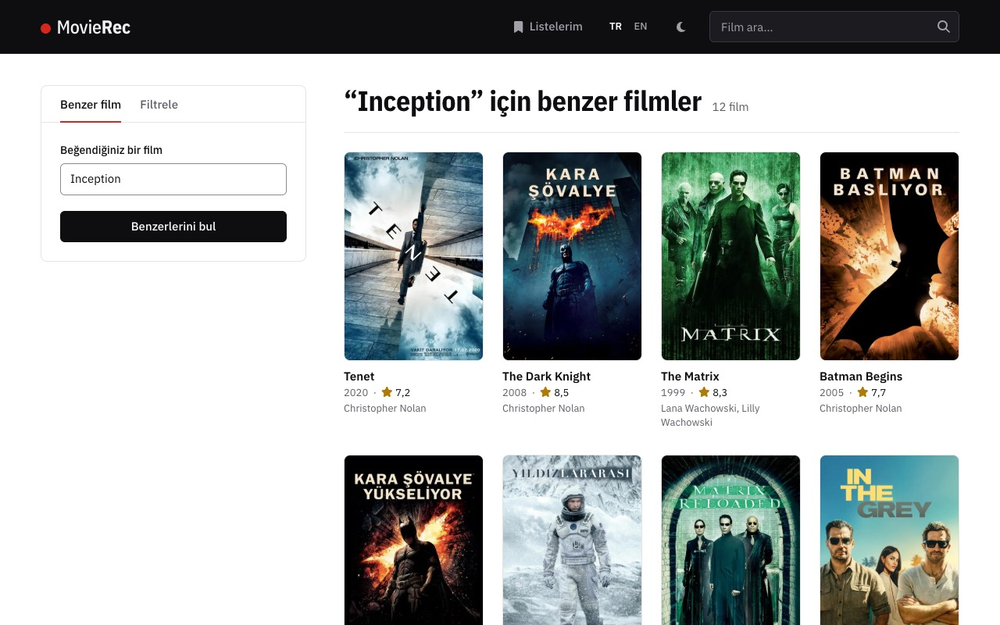
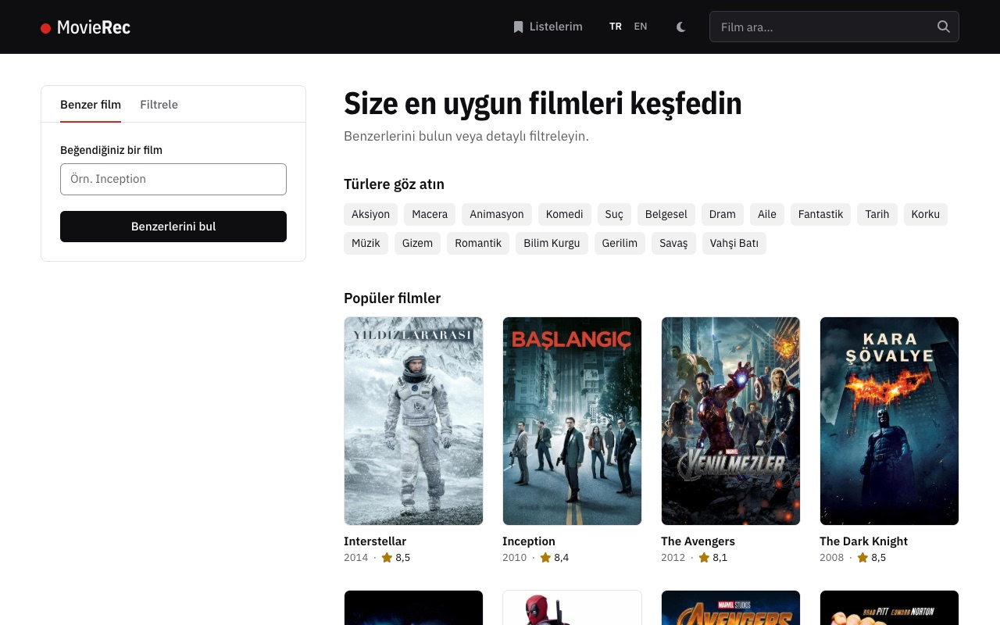
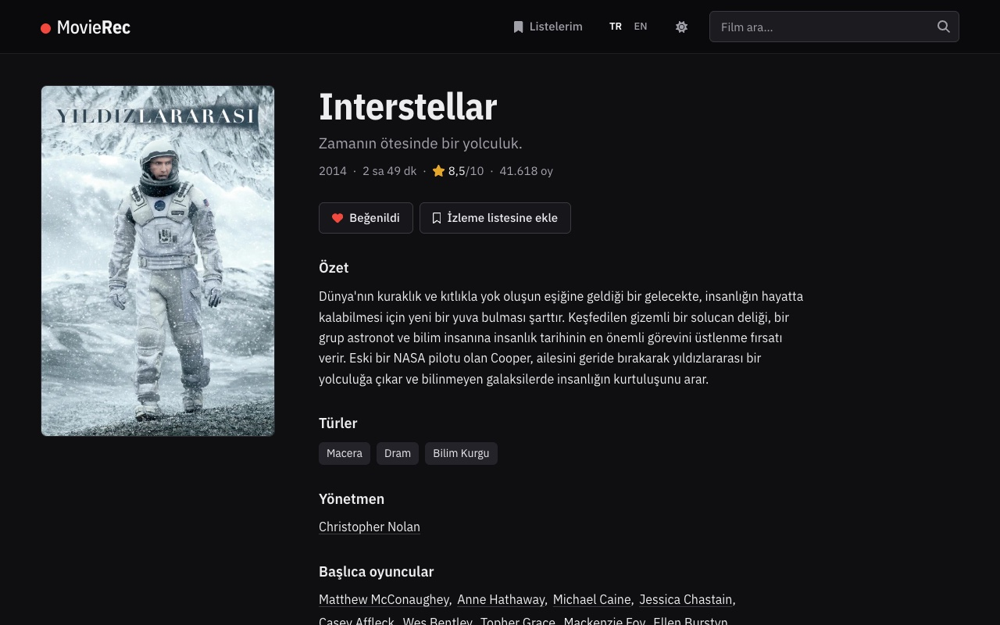
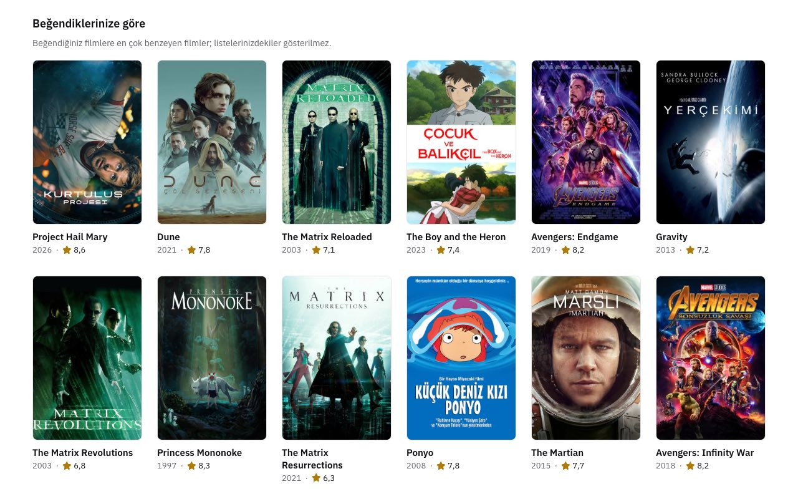

# MovieRec

[](https://github.com/alimustafaekmen/Movie-Recommendation/actions/workflows/ci.yml)
[](LICENSE)

[English](README.md) | **Türkçe**

MovieRec, TMDb filmleri için içerik tabanlı bir film öneri uygulamasıdır. Yaklaşık 14.000 filmlik canlı demo: [movierec.pages.dev](https://movierec.pages.dev)

Demodaki sonuçlar önceden hesaplanmıştır. Kişi sayfalarında biyografi yoktur ve yalnızca veri setindeki filmler listelenir.

Teknolojiler: Python 3.12, Flask, pandas, scikit-learn (TF-IDF, kosinüs benzerliği), thefuzz, vanilla JavaScript, Docker, gunicorn, GitHub Actions.

## Ekran görüntüleri

<a href="screenshots/tr/similar-movies.jpg"></a>

<p>
  <a href="screenshots/tr/home.jpg"></a>
  <a href="screenshots/tr/movie-page-dark.jpg"></a>
  <a href="screenshots/tr/my-lists.jpg"></a>
</p>

## Özellikler

- **Benzer filmler:** Bir film adı yazın, 12 benzer film gelsin. "Daha fazla göster" ile 24 filme çıkar.
- **Filtreli arama:** Tür, yönetmen, çıkış yılı ve en düşük puana göre.
- **Film ve kişi sayfaları:** TMDb API'sinden poster, özet, fragman, oyuncu kadrosu ve biyografi.
- **Beğeniler ve izleme listesi:** Tarayıcıda tutulur, üyelik gerekmez. Listeler sayfası beğendiğiniz filmlere göre öneri de sunar.
- **Açık ve koyu tema:** Sistem ayarını izler. Üst menüdeki düğmeyle değiştirilebilir.
- **Türkçe ve İngilizce:** Tür adları, tarih ve sayı biçimleri ve TMDb metinleri dahil bütün arayüz iki dilde.

## Nasıl çalışır

1. Her film dört TF-IDF bloğuna ayrılır: türler, yönetmenler, anahtar kelimeler ve metin.
2. Birleştirilen bloklar üzerinde kosinüs benzerliğiyle en yakın 91 film bulunur. Bu filmler aday havuzunu oluşturur.
3. Havuzdaki her film benzerliğine, puanına, popülerliğine ve oy sayısına göre yeniden puanlanır.
4. Uygulama ilk 12 filmi gösterir.

Collaborative filtering yerine TF-IDF seçildi, çünkü kullanıcı verisi yok ve bir eşleşmenin hangi terimlerden geldiği kolayca görülebiliyor.

| Blok | Girdi | Ağırlık |
|---|---|---|
| Türler | tür adlarının tamamı ("Science Fiction" tek terimdir) | 0.3 |
| Yönetmenler | tam adlar, ortak yönetmenler ayrı ayrı | 0.2 |
| Anahtar kelimeler | tek tek kelimeler | 0.4 |
| Metin | özet ve slogan, yaygın İngilizce kelimeler hariç | 0.6 |

Her blok ağırlığıyla çarpılmadan önce normalize edilir. Özet ayrı bir blokta olduğu için karakter adı gibi nadir bir kelime, ilgisiz iki filmi tek başına nadiren birbirine bağlar.

Yeniden sıralama ağırlıkları:

| Sinyal | Ölçekleme | Ağırlık |
|---|---|---|
| İçerik benzerliği | havuzdaki en iyi eşleşmeye bölünür | 0.50 |
| Oy ortalaması | 10'a bölünür | 0.20 |
| Popülerlik | log(1 + x), havuzdaki en büyük değere bölünür | 0.20 |
| Oy sayısı | log(1 + x), havuzdaki en büyük değere bölünür | 0.10 |

Havuzda 100 ya da daha fazla oy almış bir film varsa, 100 oyun altındaki filmler elenir. Ağırlıklar elle seçilmiş yuvarlak sayılardır ve [movierec/config.py](movierec/config.py) dosyasındadır. Yönetmen ağırlığı 0.5 iken Jaws'un ilk 8 önerisinin hepsi Spielberg filmiydi. Bu yüzden yönetmen ağırlığı 0.2'dir.

Başlık araması önce tam eşleşmeye bakar. Büyük küçük harf, aksan ve kesme işareti fark etmez. Tam eşleşme yoksa thefuzz en yakın başlığı seçer, böylece küçük yazım hataları sorun olmaz.
Yenilenmiş katalogda Türkçe adlar da aranır: "baslangic" yazınca *Inception* bulunur.

Listeler sayfasındaki öneriler için en son eklenen 20 beğeninin her birine 30 benzer film bulunur. Birden çok beğeninin ortak filmleri yukarı çıkar. Sayfa, listelerinizde henüz olmayan ilk 12 filmi gösterir.

Filtreli arama bütün filtrelere uyan filmleri alır ve `0.40 * puan + 0.45 * popülerlik + 0.15 * oy sayısı` ile sıralar. Puan 10'a bölünür. Popülerlik (log ölçeğinde) ve oy sayısı, eşleşmeler içindeki en büyük değere bölünür. 100 oyun altındaki filmler yalnızca başka eşleşme yoksa listeye girer.

## Değerlendirme

Karşılaştırılacak kullanıcı verisi olmadığı için `scripts/evaluate.py` her filmi sırayla başlangıç filmi olarak alır ve ona önerilen 12 filme bakar. Uygulamanın listeleri, saf kosinüs benzerliğiyle ve her filme aynı en çok oy almış 12 filmi veren basit bir yöntemle karşılaştırılır.

Kaggle dosyalarında (4.803 film):

| Yöntem | Tür örtüşmesi | Aynı yönetmen | Ortak başrol oyuncusu | Seri filmlerini bulma | Katalog kapsamı | Ortanca oy |
|---|---|---|---|---|---|---|
| Saf kosinüs | 0,744 | %5,6 | %3,48 | %76,7 | %98,5 | 191 |
| MovieRec (yeniden sıralanmış) | 0,739 | %5,0 | %3,55 | %75,1 | %61,7 | 1.350 |
| En çok oy alanlar | 0,159 | %0,1 | %0,75 | %1,1 | %0,3 | 10.099 |

Yaklaşık 14.000 filmlik yenilenmiş katalogda yeniden sıralanmış listelerin tür örtüşmesi yaklaşık 0,76'dır ve listeler filmlerin %80'inden fazlasına ulaşır.

- Bu sayılar listelerin tutarlılığını ölçer, insanların onları beğenip beğenmediğini ölçmez.
- Türler ve yönetmenler modelin girdisidir. Yani ilk iki sütun kısmen modele verilen bilgiyi ölçer.
- Kapsam farkının çoğu 100 oy sınırından gelir. Yeniden sıralanmış listeler, 100 ya da daha fazla oy almış filmlerin %94'üne ulaşır.

## Yerelde çalıştırma

Python 3.12 ve Kaggle'daki [TMDB 5000 veri seti](https://www.kaggle.com/datasets/tmdb/tmdb-movie-metadata) gerekir.

1. `tmdb_5000_movies.csv` ve `tmdb_5000_credits.csv` dosyalarını `dataset/` klasörüne koyun.
2. `cp .env.example .env` komutunu çalıştırıp [TMDb API anahtarınızı](https://www.themoviedb.org/settings/api) (v3) ekleyin. Anahtar olmadan uygulama yalnızca veri setiyle çalışır: poster, fragman ve kişi sayfası olmaz. Diğer ayarlar için `.env.example` dosyasına bakın.
3. Kurup başlatın:

   ```bash
   python -m venv .venv && source .venv/bin/activate
   pip install --require-hashes -r requirements.lock.txt
   python app.py
   ```

4. http://localhost:5001 adresini açın.

Kaggle dosyaları 2016'da biter. `python scripts/fetch_catalogue.py`, TMDb anahtarınızla 1990'dan bu yana her yıl için en çok oy almış en fazla 400 filmi ekler.
Dosyalar git'in yok saydığı `dataset/refreshed/` klasörüne yazılır. Kullanmak için `.env` dosyasında `DATASET_DIR=dataset/refreshed` ayarlayın.
TMDb'nin koşulları veriyi en fazla 6 ay saklamaya izin verir. Bu yüzden betiği en az 6 ayda bir yeniden çalıştırın.

Docker için önce CSV dosyalarını `dataset/` klasörüne koyun, sonra `docker compose up --build` ile uygulamayı gunicorn üzerinden http://localhost:5001 adresinde açın.
İmaj TMDb verisi içerir, bu yüzden onu hiçbir registry'ye göndermeyin.

## Bağımlılıklar

`requirements.txt` doğrudan bağımlılıkların sürümlerini sabitler, CI ve Docker ise kurulumu her paketi hash değerleriyle sabitleyen `requirements.lock.txt` dosyasından yapar. `requirements.txt` değişirse kilit dosyasını [uv](https://docs.astral.sh/uv/) ile yeniden üretin:

```bash
uv pip compile --universal --python-version 3.12 --generate-hashes --exclude-newer 14d requirements.txt -o requirements.lock.txt
```

Bir güvenlik düzeltmesi 14 günden yeniyse `--exclude-newer 14d` bayrağını çıkarın.

## Testler

```bash
ruff check . && ruff format --check .
pytest --cov
node --test "tests/js/*.test.mjs"
```

Kaggle CSV dosyaları yoksa pytest, `tests/fixtures/` içindeki küçük örnek veriyi kullanır. CI aynı komutları her push ve pull request'te çalıştırır.

## Proje yapısı

```text
app.py                  giriş noktası (gunicorn app:app)
movierec/
  dataset.py            CSV yükleme ve temizleme
  similarity.py         TF-IDF matrisi ve sıralama formülleri
  engine.py             benzer filmler, filtreli arama ve başlık araması
  tmdb.py               küçük bir TMDb API istemcisi
  i18n.py               Türkçe ve İngilizce metinler ve biçimler (messages.json)
  web/                  Flask rotaları, güvenlik başlıkları ve dil seçimi
templates/              Jinja şablonları
static/                 CSS, JavaScript, ikonlar ve yazı tipleri
scripts/                evaluate.py ve fetch_catalogue.py
tests/                  pytest testleri, tests/js/ içinde node:test testleri
```

## Sınırlamalar

- Katalog, verinin indirildiği günde biter. Öneriler yalnızca yüklenen filmlerden gelir.
- 1990 öncesi filmler yalnızca Kaggle veri setinden gelir, bu yüzden o yıllarda film sayısı azdır.
- Popülerlik, TMDb'nin indirme günündeki ilgi puanıdır. O gün vizyonda olan filmler öne çıkar.
- Öneriler yalnızca içeriğe dayanır. Bilgisi az olan filmlere çoğunlukla aynı türden filmler önerilir.
- İngilizce olmayan filmlere nadiren kendi dillerinde öneri gelir.
- Listeler JavaScript gerektirir ve tek bir cihazdaki tek bir tarayıcıda kalır.
- Uygulama kendi bilgisayarınızda çalışmak için yapılmıştır. İnternete açılacaksa önüne nginx ya da Caddy gibi bir reverse proxy konmalıdır. Bu proxy istekleri tamamen alıp öyle iletmelidir, yoksa yavaş istemciler gunicorn'un bütün thread'lerini meşgul edebilir. Ayrıca TMDb'yi sizin anahtarınızla çağıran `/api/`, `/movie/`, `/actor/` ve `/director/` adreslerinde ziyaretçi başına istek sayısını sınırlamalıdır.

## Lisans ve kaynaklar

Kaynak kod [PolyForm Noncommercial License 1.0.0](LICENSE) ile paylaşılmıştır. Kişisel, eğitim amaçlı ve diğer ticari olmayan amaçlarla kullanılabilir. Ticari kullanıma izin verilmez.

- Film verileri ve görseller [TMDB](https://www.themoviedb.org/) kaynaklıdır. Bu web sitesi TMDB'yi ve TMDB API'lerini kullanır, ancak TMDB tarafından onaylanmamış, sertifikalandırılmamış veya başka bir şekilde desteklenmemiştir.
- Temel veri seti, Kaggle'daki [TMDB 5000 Movie Dataset](https://www.kaggle.com/datasets/tmdb/tmdb-movie-metadata) veri setidir.
- `static/icons.svg` içindeki ikonlar [Font Awesome Free 6.5.1](https://fontawesome.com) kaynaklıdır ve kendi [CC BY 4.0 lisanslarıyla](https://fontawesome.com/license/free) kullanılır.
- Yazı tipleri [IBM Plex Sans ve IBM Plex Sans Condensed](https://github.com/IBM/plex) olup SIL Open Font License 1.1 kapsamındadır (`static/fonts/OFL.txt`). Yazı tipi dosyalarını site kendisi sunar.
